<!-- ───────────────────────────── BANNER ───────────────────────────── -->

  

<!-- ───────────────────────────── SOCIALS ───────────────────────────── -->

  
  
  
  
  
  

  

<!-- ───────────────────────────── ABOUT ───────────────────────────── -->
<h2 align="center">👨‍🚀 About me</h2>

Hello there! I'm ***Sri Venkat Reddy***, a final-year Computer Science student who likes building AI systems end-to-end — from agent orchestration and retrieval pipelines to the APIs and infra that put them in front of users. Most of my time goes into multi-agent architectures, RAG, and geospatial intelligence.

  🏛️ <b><i>B.Tech CSE @ GRIET, Hyderabad (2023–27)</i></b> 
  🤖 <b><i>Building Loom — an agentic AI pair-programmer for the terminal</i></b> 
  🛰️ <b><i>Building Prism Earth — geospatial intelligence for India</i></b> 
  🌱 <b><i>Contributing to open-source AI / ML</i></b> 
  📫 <b><i>srivenkatreddy2208@gmail.com</i></b>

 

<!-- ───────────────────────────── PROJECTS ───────────────────────────── -->
<h2 align="center">🚧 Currently Building</h2>

| Project | What it is | Stack |
|:--|:--|:--|
| **Loom** | Agentic AI pair-programming CLI — orchestrator agent over MCP, persistent vector + relational memory, provider-agnostic LLMs | `Python` `LangGraph` `MCP` `pgvector` |
| [**Prism Earth**](https://github.com/sri-venkat-22/Prism-Earth) | Geospatial intelligence platform for India — Planner → Fetch → Synthesizer over ISRO Bhuvan & Sentinel-2 | `FastAPI` `PostgreSQL` `Redis` `React` |
| [**AEGIS Twin**](https://github.com/sri-venkat-22/Logistics-Simulation) | Logistics digital-twin dashboard with simulation engines | `Python` `React` |

<!-- ───────────────────────────── TECH ───────────────────────────── -->
<h2 align="center">⚙️ Technologies</h2>

  
  
  
  
  
  
  
   
  
  
  
  
  
  
  
   
  
  
  
  
  
  
  
  

<!-- ───────────────────────────── STATS ───────────────────────────── -->
<h2 align="center">📈 Statistics</h2>

  
  

  

  <picture>
    <source media="(prefers-color-scheme: dark)" srcset="https://raw.githubusercontent.com/sri-venkat-22/sri-venkat-22/output/snake-dark.svg" />
    <source media="(prefers-color-scheme: light)" srcset="https://raw.githubusercontent.com/sri-venkat-22/sri-venkat-22/output/snake-light.svg" />
    
  </picture>

<!-- ───────────────────────────── FOOTER ───────────────────────────── -->

  

